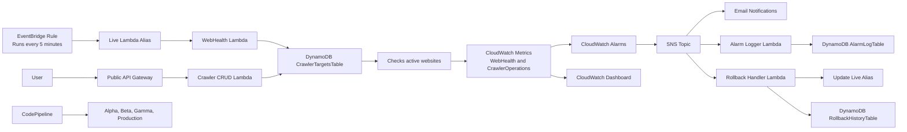

# Joshua AWS Website Health Monitoring

This project is an AWS Cloud Development Kit (CDK) solution for managing website-monitoring targets and checking their availability, latency, and HTTP response status. A public API Gateway REST API provides CRUD operations backed by DynamoDB. A scheduled Lambda reads active targets from that same table and publishes custom CloudWatch metrics; alarms, SNS notifications, a dashboard, and a custom Lambda-alias rollback handler support operations.

## Project Purpose

The project demonstrates the Applied Project requirements alongside the original website-health monitoring application:

- Manage the list of monitored sites through a public REST API.
- Store target records in DynamoDB and connect them to the scheduled crawler.
- Measure DynamoDB read/write latency and website availability, request latency, and HTTP status.
- Test the API and monitoring behavior across unit, functional, and integration stages in CodePipeline.
- Monitor operational health using CloudWatch alarms and a dashboard.

The API is public and currently unauthenticated. Review the security and usage notes in the API documentation before exposing it to production users.

## AWS Architecture

The infrastructure is defined in the CDK stack in `joshua/joshua_stack.py`. The architecture combines several AWS services:

- EventBridge invokes the `Live` Lambda alias every 5 minutes
- The scheduled Lambda reads active website targets from DynamoDB and checks them
- API Gateway routes target CRUD requests to a CRUD Lambda
- The CRUD Lambda reads and writes the DynamoDB target table
- CloudWatch stores custom metrics
- CloudWatch alarms evaluate metric thresholds
- SNS publishes notifications when an alarm fires
- DynamoDB stores alarm records for later review
- A rollback Lambda moves the `Live` alias to an earlier published version when an operational alarm fires
- CloudWatch dashboard visualises key website metrics
- CodePipeline deploys Alpha, Beta, Gamma, and Production stages and runs their corresponding test suites



### Main AWS Components

- `WebHealthLambda` monitors websites and writes metrics to CloudWatch
- `AlarmLoggerLambda` processes SNS alarm notifications and writes them to DynamoDB
- `LambdaInvocationRule` invokes the `Live` alias on a five-minute schedule
- `AlarmLogTable` stores alarm metadata and raw notification payloads
- `RollbackHandlerLambda` reverts `Live` to the previous published version for operational alarms
- `RollbackHistoryTable` records rollback attempts and outcomes
- `AlarmNotifications` SNS topic handles email and Lambda-based alarm subscription actions
- `WebHealthMonitoring` CloudWatch dashboard visualises key metrics
- `CrawlerApi` exposes the target-list CRUD API at the `prod` stage
- `CrawlerTargetsTable` stores target IDs, URLs, and active/paused status

## Lambda Functions

### 1. WebHealth Lambda

The function in `joshua/resources/webhealth.py` performs the monitoring checks.

For each active target in `CrawlerTargetsTable`, it:

- Opens each URL using Python's `urllib` library
- Measures the response time from the request start to completion
- Records the HTTP status code returned by the server
- Marks availability as `1` when the request succeeds and `0` otherwise
- Pushes website metrics to CloudWatch under the `WebHealth` namespace

The custom metrics are defined in `joshua/resources/constants.py`:

- `AVAILABILITY_METRIC`
- `LATENCY_METRIC`
- `HTTP_STATUS_CODE`

The helper used to send the metrics is in `joshua/resources/CWPutData.py`.

Targets are created and maintained through the API below. Paused targets are not checked. An empty table means no website requests are made during that run.

### 2. Alarm Logger Lambda

The function in `joshua/resources/alarm_logger.py` handles CloudWatch alarm messages from an SNS topic.

It:

- Reads the SNS message payload
- Parses the JSON alarm data
- Stores the alarm details in DynamoDB

This allows alarm activity to be retained for later analysis.

## CloudWatch Metrics

The project uses a custom CloudWatch namespace named `WebHealth`. The metrics use the `URL` dimension so measurements for each monitored site can be distinguished in CloudWatch.

### Metrics

1. `AVAILABILITY_METRIC`
   - Binary metric: `1` means available, `0` means unavailable
   - Unit: `None`

2. `LATENCY_METRIC`
   - Measures how long the website takes to respond
   - Unit: `Seconds`

3. `HTTP_STATUS_CODE`
   - Captures the HTTP status code returned by the site
   - Unit: `None`

These metrics are stored in CloudWatch and used for dashboards and alarms.

## CloudWatch Alarms

The stack defines website alarms for each monitored site, plus Lambda operational alarms:

### Website Availability Alarm

- Alarm name: `WebsiteAvailabilityAlarm`
- Trigger: availability falls below `0.9`
- Evaluation periods: `2`
- Missing data handling: `BREACHING`
- Purpose: detects a significant outage or a site that is not responding as expected

### Website Latency Alarm

- Alarm name: `WebsiteLatencyAlarm`
- Trigger: latency exceeds `2` seconds
- Evaluation periods: `2`
- Missing data handling: `BREACHING`
- Purpose: detects slow website performance

### HTTP Status Alarm

- Alarm name: `WebsiteHttpStatusAlarm`
- Trigger: HTTP status code exceeds `400`
- Evaluation periods: `2`
- Missing data handling: `BREACHING`
- Purpose: detects 4xx and 5xx errors

Each alarm is connected to the SNS topic, which sends notifications.

### Lambda Operational Alarms

- `CrawlerErrorAlarm` triggers when the aliased Lambda reports an error.
- `CrawlerDurationAlarm` triggers when average duration exceeds 25 seconds.
- `CrawlerInvocationsAlarm` triggers after two consecutive five-minute periods with fewer than one invocation, including missing data.

All three operational alarms notify the rollback handler. The handler updates the `Live` alias to the highest published version below its current version and records the result in `RollbackHistoryTable`. This is a custom alias-based rollback; it does not use CodeDeploy.

### Canary and Release Gate

The CodePipeline deploys and tests Alpha, Beta, and Gamma before Production. After Gamma's deployment and integration tests, `CanarySmokeTest` invokes its `Live` alias and fails the pipeline if the Lambda reports an execution error or does not return `statusCode: 200`. Production cannot be promoted through the pipeline unless this check passes; production also has operational alarms that invoke the rollback handler.

This is a synthetic smoke-test gate, not weighted/percentage-based traffic shifting, and it does not wait for CloudWatch alarms to evaluate. The application publishes a new version to the alias when its stack is deployed. The test gates promotion to Production but is not a post-deployment Production check.

These stages gate progression through CodePipeline; they do not report a GitHub required status check or block merging a pull request. Configure GitHub branch protection with an appropriate required check if merges must be blocked.

**Crawler integration:** the scheduled `WebHealthLambda` reads all target records from `CrawlerTargetsTable` on each run, follows DynamoDB pagination, and checks only records with `status: "active"`. Create targets with `POST /targets` to add checks; paused targets are ignored. An empty target table results in a successful run with no website requests or per-website metrics.

### DynamoDB latency metrics

Target-table reads and writes are timed with a monotonic clock and published to CloudWatch in the `CrawlerOperations` namespace. `DynamoDBReadLatency` covers `get_target`, `list_targets`, and `list_crawl_targets`; `DynamoDBWriteLatency` covers `create_target`, `update_target`, and `delete_target`. Each metric has an `Operation` dimension and uses milliseconds. Average read and write latency are graphed on the `WebHealthDashboard`. If publishing a timing metric fails, the error is logged without changing the outcome of the DynamoDB operation.

### Applied Project tests

The test suite has **42 collected tests**. Counts below group each test by its primary purpose, so one test is counted only once:

| Pipeline stage | Tests | Applied Project | Website monitoring / infrastructure |
|---|---:|---:|---:|
| Alpha unit tests | 22 | 5 | 17 |
| Beta functional tests | 16 | 7 | 9 |
| Gamma integration tests | 4 | 3 | 1 |
| **Total** | **42** | **15** | **27** |

Applied Project tests include the five explicitly numbered CRUD/latency unit tests, three API CRUD handler tests, four target-table/crawler functional tests, and three integration tests: DynamoDB CRUD/latency, CloudWatch metric publication for a managed target, and crawler behavior for active versus paused DynamoDB targets. The other tests cover the CDK infrastructure, rollback behavior, website HTTP metrics, and alarm logging. Within each test file, test comments identify the test's purpose and number where useful.

Run the suites from the `Joshua` project directory:

```bash
python -m pip install -r requirements.txt
python -m pip install pytest
python -m pytest tests/unit
python -m pytest tests/functional
python -m pytest tests/integration
python -m pytest
```

Unit and functional tests use mocks or an in-memory DynamoDB stand-in and do not require AWS credentials. Integration tests use either a running LocalStack endpoint (`AWS_ENDPOINT_URL`) or deployed Gamma AWS resources. Gamma sets `RUN_AWS_INTEGRATION_TESTS=true` and supplies the deployed table names; missing AWS configuration fails rather than silently skipping tests. A local run without LocalStack or Gamma configuration skips the four integration tests.

## Crawler Targets REST API

### Base URL and deployment

The REST API is internet-accessible at the API Gateway `prod` stage. After the Gamma application stack has deployed, retrieve its `CrawlerApiUrl` CloudFormation output from that stack's **Outputs** tab. Use the value as `API_BASE_URL`; it includes the API ID, AWS region, and `/prod` stage. If needed, find the invoke URL in the AWS API Gateway console under **CrawlerApi → Stages → prod**.

All endpoints below are relative to `API_BASE_URL`. JSON request bodies must use `Content-Type: application/json`.

| Method and path | Description | Success response |
|---|---|---|
| `GET /targets` | List all targets (DynamoDB scan pages are read internally). | `200 OK`, JSON array |
| `POST /targets` | Create a target. | `201 Created`, created target |
| `GET /targets/{target_id}` | Read one target. | `200 OK`, target object |
| `PUT /targets/{target_id}` | Update its URL, status, or both. | `200 OK`, updated target |
| `DELETE /targets/{target_id}` | Delete one target. | `200 OK`, deleted target |

Each target has this shape:

```json
{
  "target_id": "site-1",
  "url": "https://example.com",
  "status": "active"
}
```

`target_id` is a non-empty string, trimmed for surrounding whitespace, with a maximum length of 256 characters. `url` must be a valid HTTP or HTTPS URL with a hostname and no embedded username/password. A newly created target always starts as `active`. `status` is either `active` or `paused`; paused targets remain stored but are ignored by the scheduled crawler.

### Create a target

`POST /targets` accepts only `target_id` and `url`; the service sets `status` to `active`.

```bash
curl -X POST "$API_BASE_URL/targets" \
  -H "Content-Type: application/json" \
  -d '{"target_id":"site-1","url":"https://example.com"}'
```

Example response (`201 Created`):

```json
{
  "target_id": "site-1",
  "url": "https://example.com",
  "status": "active"
}
```

Creating an existing ID returns `409 Conflict`. Extra properties, missing/invalid IDs, and invalid URLs return `400 Bad Request`.

### List and read targets

```bash
curl "$API_BASE_URL/targets"
curl "$API_BASE_URL/targets/site-1"
```

The list endpoint reads every DynamoDB scan page before returning a JSON array. The single-target endpoint returns `404 Not Found` if the ID does not exist.

### Update a target

`PUT /targets/{target_id}` accepts either or both of `url` and `status`; unknown properties and an empty update are rejected.

```bash
curl -X PUT "$API_BASE_URL/targets/site-1" \
  -H "Content-Type: application/json" \
  -d '{"url":"https://www.example.com/health","status":"paused"}'
```

The response contains the updated target. Invalid URL/status values return `400 Bad Request`; an unknown target returns `404 Not Found`.

### Delete a target

```bash
curl -X DELETE "$API_BASE_URL/targets/site-1"
```

The response contains the deleted target. Deleting an unknown ID returns `404 Not Found`.

### Error responses and access controls

Lambda validation errors use a JSON body such as `{"error":"Target not found."}`. The configured Lambda routes return:

- `400 Bad Request` for malformed JSON, invalid fields, invalid target IDs/URLs, or invalid statuses.
- `404 Not Found` when reading, updating, or deleting a target that does not exist.
- `409 Conflict` when creating a target ID that already exists.
- `500 Internal Server Error` when DynamoDB fails unexpectedly.

API Gateway handles methods and paths that are not configured; depending on the request, it may return `403 Missing Authentication Token`.

The API currently has no request authentication or authorization. API Gateway throttles the shared `prod` stage at 10 requests per second with a burst limit of 20; throttling does not prevent anonymous access or abuse. CORS permits any origin (`*`) and should be restricted when the client origin is known. Do not use this unauthenticated configuration for sensitive target data or unrestricted production access.

The target table has point-in-time recovery enabled and uses a retain removal policy, so deleting a stack leaves the table and its data in the account. Retained tables may need to be removed manually when no longer required; point-in-time recovery can incur additional AWS charges.

## SNS Notifications

The project creates an SNS topic named `AlarmNotifications`.

It is configured to:

- Send email notifications to the configured address
- Trigger the `AlarmLoggerLambda` to record alarm information in DynamoDB

This provides both real-time notification and persistent alarm history.

## DynamoDB Alarm Logging

The table `AlarmLogTable` stores alarm events emitted by CloudWatch alarms.

The schema includes:

- `alarm_name` (partition key)
- `state_change_time` (sort key)
- `new_state`
- `reason`
- `region`
- `account_id`
- `raw_message`

This makes it easier to review:

- when an alarm fired
- why it fired
- whether the issue was an outage, latency problem, or HTTP error
- the raw details contained in the original notification

## CloudWatch Dashboard

A dashboard named `WebHealthMonitoring` is created with widgets for:

- Website Availability
- Website Latency
- HTTP Status Codes
- Lambda invocations and errors
- Lambda processing duration
- Crawler target DynamoDB read latency
- Crawler target DynamoDB write latency

This gives a visual overview of the health of the monitored website endpoints in a single AWS dashboard.

## Deployment and Setup Instructions

### Prerequisites

Before deploying the project, you should have:

- Python 3.x
- Node.js and npm
- AWS CLI configured with valid AWS credentials
- AWS CDK installed globally

### Install AWS CDK

```bash
npm install -g aws-cdk
```

### Clone the Repository

```bash
git clone https://github.com/JoshuKr-droid/WSU2026.git
cd WSU2026/Joshua
```

Activate the virtual environment:

On macOS/Linux:

```bash
source .venv/bin/activate
```

On Windows PowerShell:

```powershell
.\.venv\Scripts\Activate.ps1
```

Install project dependencies:

```bash
python -m pip install -r requirements.txt
```

Install development/test dependencies if they are not already present:

```bash
python -m pip install -r requirements-dev.txt
```

### Deploy the Stack

The CDK app deploys the CodePipeline stack. Configure AWS credentials and a default account/region first. The pipeline source currently polls the `main` branch of `JoshuKr-droid/WSU2026` and reads the GitHub token from the Secrets Manager secret `gitToken`. Bootstrap the target environment once if it has not already been bootstrapped:

```bash
cdk bootstrap aws://<AWS_ACCOUNT_ID>/<AWS_REGION>
```

From the `Joshua` project folder, synthesise and deploy:

```bash
cdk synth
cdk deploy
```

The pipeline deploys Alpha, Beta, and Gamma before the Production stage. Production promotion requires the configured manual approval. The application stage creates the API and monitoring resources; the Gamma application stack's `CrawlerApiUrl` output provides the API base URL for the Gamma deployment.

### Useful CDK Commands

```bash
cdk ls
cdk synth
cdk diff
cdk deploy
```

## Repository Structure

```text
.
├── app.py
├── cdk.json
├── README.md
├── requirements.txt
├── requirements-dev.txt
├── joshua/
│   ├── __init__.py
│   ├── joshua_stack.py
│   ├── pipeline_stack.py
│   ├── pipeline_stage.py
│   └── resources/
│       ├── crawler_crud.py
│       ├── webhealth.py
│       ├── operational_metrics.py
│       ├── CWPutData.py
│       ├── alarm_logger.py
│       ├── rollback_handler.py
│       └── constants.py
├── tests/
│   ├── __init__.py
│   ├── unit/
│   │   ├── test_crawler_crud.py
│   │   ├── test_joshua_stack.py
│   │   ├── test_operational_metrics.py
│   │   └── test_rollback_handler.py
│   ├── functional/
│   │   ├── test_crawler_crud.py
│   │   ├── test_crawler_targets.py
│   │   └── test_webhealth.py
│   └── integration/
│       ├── __init__.py
│       ├── aws_test_support.py
│       ├── test_alarm_logger_integration.py
│       ├── test_cloudwatch_integration.py
│       └── test_crawler_crud_integration.py
```

## Notes

- The project uses `WebHealth` and `CrawlerOperations` as custom CloudWatch namespaces.
- The monitoring rule runs every 5 minutes and invokes the `Live` Lambda alias.
- The HTTP status metric preserves HTTP error response codes (for example, 404 or 503) and measures their request latency.
- SNS email subscriptions may require confirmation before email alerts are delivered.
- Ensure your AWS credentials and default region are configured correctly before deployment.

## Summary

This project combines a public DynamoDB-backed target-management API with a scheduled website crawler, operational and website CloudWatch metrics, alarms, SNS notifications, DynamoDB alarm history, dashboard visualisation, and custom Lambda alias rollback. Unit, functional, and integration tests are run at the corresponding CodePipeline stages. The API is currently unauthenticated, and the live Gamma AWS integration run and GitHub Project dashboard update should be verified separately before presentation.
