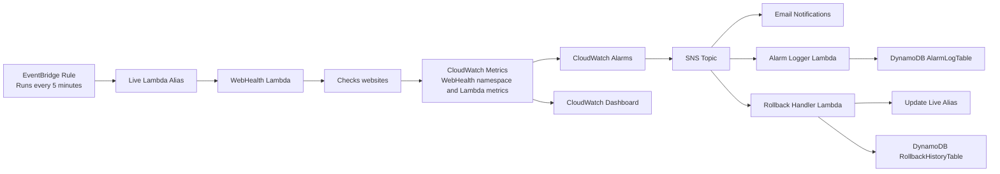

# Joshua AWS Website Health Monitoring

This project is an AWS Cloud Development Kit (CDK) solution for monitoring the availability, latency, and HTTP response status of university and public websites. It continuously checks key web endpoints, publishes custom metrics to CloudWatch, triggers alarms when thresholds are breached, and stores alarm details in DynamoDB for auditing and troubleshooting.

## Project Purpose

The purpose of this project is to provide an automated website monitoring system in AWS. It helps track the health of critical web services by measuring:

- Availability of each site
- Response time or latency
- HTTP status codes returned by the site

The solution is designed for ongoing monitoring and operational awareness, especially for high-importance university and public web services.

## AWS Architecture

The infrastructure is defined in the CDK stack in `joshua/joshua_stack.py`. The architecture combines several AWS services:

- EventBridge invokes the `Live` Lambda alias every 5 minutes
- Lambda checks the configured websites
- CloudWatch stores custom metrics
- CloudWatch alarms evaluate metric thresholds
- SNS publishes notifications when an alarm fires
- DynamoDB stores alarm records for later review
- A rollback Lambda moves the `Live` alias to an earlier published version when an operational alarm fires
- CloudWatch dashboard visualises key website metrics



### Main AWS Components

- `WebHealthLambda` monitors websites and writes metrics to CloudWatch
- `AlarmLoggerLambda` processes SNS alarm notifications and writes them to DynamoDB
- `LambdaInvocationRule` invokes the `Live` alias on a five-minute schedule
- `AlarmLogTable` stores alarm metadata and raw notification payloads
- `RollbackHandlerLambda` reverts `Live` to the previous published version for operational alarms
- `RollbackHistoryTable` records rollback attempts and outcomes
- `AlarmNotifications` SNS topic handles email and Lambda-based alarm subscription actions
- `WebHealthMonitoring` CloudWatch dashboard visualises key metrics

## Lambda Functions

### 1. WebHealth Lambda

The function in `joshua/resources/webhealth.py` performs the monitoring checks.

It:

- Defines a list of URLs to inspect
- Opens each URL using Python's `urllib` library
- Measures the response time from the request start to completion
- Records the HTTP status code returned by the server
- Marks availability as `1` when the request succeeds and `0` otherwise
- Pushes the metrics to CloudWatch under the `WebHealth` namespace

The code currently monitors the following URLs:

- `https://www.westernsydney.edu.au/`
- `https://www.unsw.edu.au/`
- `https://www.sydney.edu.au/`

The custom metrics are defined in `joshua/resources/constants.py`:

- `AVAILABILITY_METRIC`
- `LATENCY_METRIC`
- `HTTP_STATUS_CODE`

The helper used to send the metrics is in `joshua/resources/CWPutData.py`.

### 2. Alarm Logger Lambda

The function in `joshua/resources/alarm_logger.py` handles CloudWatch alarm messages from an SNS topic.

It:

- Reads the SNS message payload
- Parses the JSON alarm data
- Stores the alarm details in DynamoDB

This allows alarm activity to be retained for later analysis.

## CloudWatch Metrics

The project uses a custom CloudWatch namespace named `WebHealth`. The metrics use the `URL` dimension so measurements for each monitored site can be distinguished in CloudWatch.

### Metrics

1. `AVAILABILITY_METRIC`
   - Binary metric: `1` means available, `0` means unavailable
   - Unit: `None`

2. `LATENCY_METRIC`
   - Measures how long the website takes to respond
   - Unit: `Seconds`

3. `HTTP_STATUS_CODE`
   - Captures the HTTP status code returned by the site
   - Unit: `None`

These metrics are stored in CloudWatch and used for dashboards and alarms.

## CloudWatch Alarms

The stack defines website alarms for each monitored site, plus Lambda operational alarms:

### Website Availability Alarm

- Alarm name: `WebsiteAvailabilityAlarm`
- Trigger: availability falls below `0.9`
- Evaluation periods: `2`
- Missing data handling: `BREACHING`
- Purpose: detects a significant outage or a site that is not responding as expected

### Website Latency Alarm

- Alarm name: `WebsiteLatencyAlarm`
- Trigger: latency exceeds `2` seconds
- Evaluation periods: `2`
- Missing data handling: `BREACHING`
- Purpose: detects slow website performance

### HTTP Status Alarm

- Alarm name: `WebsiteHttpStatusAlarm`
- Trigger: HTTP status code exceeds `400`
- Evaluation periods: `2`
- Missing data handling: `BREACHING`
- Purpose: detects 4xx and 5xx errors

Each alarm is connected to the SNS topic, which sends notifications.

### Lambda Operational Alarms

- `CrawlerErrorAlarm` triggers when the aliased Lambda reports an error.
- `CrawlerDurationAlarm` triggers when average duration exceeds 25 seconds.
- `CrawlerInvocationsAlarm` triggers after two consecutive five-minute periods with fewer than one invocation, including missing data.

All three operational alarms notify the rollback handler. The handler updates the `Live` alias to the highest published version below its current version and records the result in `RollbackHistoryTable`. This is a custom alias-based rollback; it does not use CodeDeploy.

### Canary and Release Gate

The CodePipeline deploys and tests Alpha, Beta, and Gamma before Production. After Gamma's deployment and integration tests, `CanarySmokeTest` invokes its `Live` alias and fails the pipeline if the Lambda reports an execution error or does not return `statusCode: 200`. Production cannot be promoted through the pipeline unless this check passes; production also has operational alarms that invoke the rollback handler.

This is a synthetic smoke-test gate, not weighted/percentage-based traffic shifting, and it does not wait for CloudWatch alarms to evaluate. The application publishes a new version to the alias when its stack is deployed. The test gates promotion to Production but is not a post-deployment Production check.

These stages gate progression through CodePipeline; they do not report a GitHub required status check or block merging a pull request. Configure GitHub branch protection with an appropriate required check if merges must be blocked.

**Crawler integration:** the scheduled `WebHealthLambda` reads all target records from `CrawlerTargetsTable` on each run, follows DynamoDB pagination, and checks only records with `status: "active"`. Create targets with `POST /targets` to add checks; paused targets are ignored. An empty target table results in a successful run with no website requests or per-website metrics.

### DynamoDB latency metrics

Target-table reads and writes are timed with a monotonic clock and published to CloudWatch in the `CrawlerOperations` namespace. `DynamoDBReadLatency` covers `get_target`, `list_targets`, and `list_crawl_targets`; `DynamoDBWriteLatency` covers `create_target`, `update_target`, and `delete_target`. Each metric has an `Operation` dimension and uses milliseconds. Average read and write latency are graphed on the `WebHealthDashboard`. If publishing a timing metric fails, the error is logged without changing the outcome of the DynamoDB operation.

### Applied Project tests

The Alpha unit-test stage includes five numbered Applied Project unit tests: two verify read/write latency metrics, and three check malformed input, duplicate target IDs, and invalid update status. The Beta functional-test stage includes three numbered API-handler tests covering create/read, update, and delete/not-found behavior against a stateful in-memory table. The Gamma integration-test stage includes one numbered CRUD lifecycle test against a real LocalStack DynamoDB table; it skips when LocalStack is not available and also verifies read/write latency metric emission.

## Crawler target API behavior

The REST API is internet-accessible and currently has no request authentication. API Gateway throttles the shared `prod` stage at 10 requests per second with a burst limit of 20. These limits help control traffic but do not prevent anonymous use or abuse. CORS allows browser requests from any origin; restrict this to the application’s origin when it is known.

- `POST /targets` accepts `{"target_id":"site-1","url":"https://example.com"}` and creates the target with status `active`. IDs must be non-empty strings of at most 256 characters; URLs must be HTTP or HTTPS and cannot contain credentials. Reusing an ID returns `409 Conflict`.
- `GET /targets` returns all targets, following DynamoDB scan pagination internally. `GET /targets/{target_id}` returns one target or `404 Not Found`.
- `PUT /targets/{target_id}` accepts either or both of `url` and `status`. Valid statuses are `active` and `paused`; unknown fields, invalid status values, and empty updates return `400 Bad Request`. A missing target returns `404 Not Found`.
- `DELETE /targets/{target_id}` returns the deleted target or `404 Not Found` if it did not exist.

The target table has point-in-time recovery enabled and uses a retain removal policy, so deleting a stack leaves the table and its data in the account. Retained tables may need to be removed manually when no longer required; point-in-time recovery can incur additional AWS charges.

## SNS Notifications

The project creates an SNS topic named `AlarmNotifications`.

It is configured to:

- Send email notifications to the configured address
- Trigger the `AlarmLoggerLambda` to record alarm information in DynamoDB

This provides both real-time notification and persistent alarm history.

## DynamoDB Alarm Logging

The table `AlarmLogTable` stores alarm events emitted by CloudWatch alarms.

The schema includes:

- `alarm_name` (partition key)
- `state_change_time` (sort key)
- `new_state`
- `reason`
- `region`
- `account_id`
- `raw_message`

This makes it easier to review:

- when an alarm fired
- why it fired
- whether the issue was an outage, latency problem, or HTTP error
- the raw details contained in the original notification

## CloudWatch Dashboard

A dashboard named `WebHealthMonitoring` is created with widgets for:

- Website Availability
- Website Latency
- HTTP Status Codes
- Lambda invocations and errors
- Lambda processing duration
- Crawler target DynamoDB read latency
- Crawler target DynamoDB write latency

This gives a visual overview of the health of the monitored website endpoints in a single AWS dashboard.

## Deployment and Setup Instructions

### Prerequisites

Before deploying the project, you should have:

- Python 3.x
- Node.js and npm
- AWS CLI configured with valid AWS credentials
- AWS CDK installed globally

### Install AWS CDK

```bash
npm install -g aws-cdk
```

### Fork and Clone the Repository

1. Log in to your GitHub account.
2. Fork the repo: https://github.com/AyeshaOmer/WSU2026.git
3. Copy the web URL of your fork.
4. Clone the forked repo:

```bash
git clone <your_fork_url>
```

5. Create your project folder in the repo:

```bash
mkdir <your_name>
cd <your_name>
```

6. Initialise a Python CDK project:

```bash
cdk init --language python
```

7. Activate the virtual environment:

On macOS/Linux:

```bash
source .venv/bin/activate
```

On Windows PowerShell:

```powershell
.\.venv\Scripts\Activate.ps1
```

8. Install project dependencies:

```bash
python -m pip install -r requirements.txt
```

### Deploy the Stack

From the project folder, run:

```bash
cdk synth
cdk deploy
```

This synthesises the CloudFormation stack and deploys the AWS infrastructure to your configured AWS account and region.

### Useful CDK Commands

```bash
cdk ls
cdk synth
cdk diff
cdk deploy
```

## Repository Structure

```text
.
├── app.py
├── cdk.json
├── README.md
├── requirements.txt
├── requirements-dev.txt
├── source.bat
├── joshua/
│   ├── __init__.py
│   ├── joshua_stack.py
│   └── resources/
│       ├── CWPutData.py
│       ├── alarm_logger.py
│       ├── constants.py
│       └── webhealth.py
├── tests/
│   └── unit/
│       └── test_joshua_stack.py
└── .venv/
```

## Notes

- The project uses `WebHealth` as the custom CloudWatch namespace.
- The monitoring rule runs every 5 minutes and invokes the `Live` Lambda alias.
- The HTTP status metric preserves HTTP error response codes (for example, 404 or 503) and measures their request latency.
- SNS email subscriptions may require confirmation before email alerts are delivered.
- Ensure your AWS credentials and default region are configured correctly before deployment.

## Summary

This project demonstrates a practical AWS monitoring solution built with Python CDK. It combines scheduled website checks, custom CloudWatch metrics, alarm thresholds, SNS notifications, DynamoDB logging, and a dashboard to give a clear operational view of website health across multiple public endpoints.
